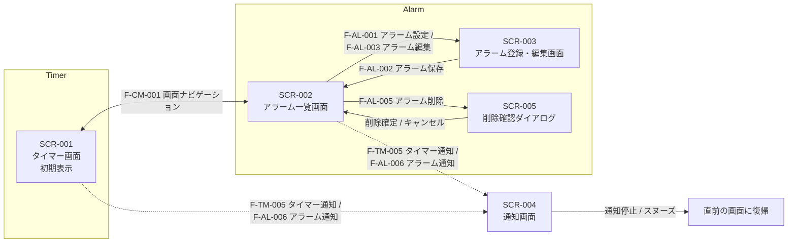

# 画面一覧・画面遷移仕様書

## 1. 画面一覧

|画面ID     |画面名              |目的                                       |
|:---------|:------------------|:------------------------------------------|
|SCR-001   |タイマー画面         |タイマーを設定し、カウントダウンの開始・一時停止・キャンセルを行う画面   |
|SCR-002   |アラーム一覧画面      |保存されたアラームを表示し、ON/OFFの切替、削除を行う画面      |
|SCR-003   |アラーム登録・編集画面 |アラームの新規登録および既存アラームの編集を行う画面         |
|SCR-004   |通知画面             |タイマーやアラームの通知時に表示される画面       |
|SCR-005   |削除確認ダイアログ     |削除する際にユーザーに確認を行う画面           |

## 2. 機能・画面対応表

## 2.1 共通機能
|機能ID   |機能名              |SCR-001 |SCR-002 |SCR-003 |SCR-004 |SCR-005 |
|:-------|:-------------------|:-------|:-------|:-------|:-------|:-------|
|F-CM-001|画面ナビゲーション     |○       |○       |-       |-       |-       |
|F-CM-002|バックグラウンド処理   |○        |○       |○       |○      |○       |
|F-CM-003|通知制御             |-        |-       |-       |○      |-       |

## 2.2 タイマー機能
|機能ID   |機能名              |SCR-001 |SCR-002 |SCR-003 |SCR-004 |SCR-005 |
|:-------|:-------------------|:-------|:-------|:-------|:-------|:-------|
|F-TM-001|タイマー時間設定       |○       |-       |-       |-       |-      |
|F-TM-002|タイマー開始          |○       |-       |-       |-       |-       |
|F-TM-003|一時停止             |○       |-       |-       |-       |-       |
|F-TM-004|再開                |○       |-       |-       |-       |-       |
|F-TM-005|タイマー通知          |-       |-       |-       |○       |-       |
|F-TM-006|キャンセル           |○       |-       |-       |-       |-       |

## 2.3 アラーム機能
|機能ID   |機能名              |SCR-001 |SCR-002 |SCR-003 |SCR-004 |SCR-005 |
|:-------|:-------------------|:-------|:-------|:-------|:-------|:-------|
|F-AL-001|アラーム設定          |-       |-       |○       |-       |-       |
|F-AL-002|アラーム保存          |-       |○       |○       |-       |-       |
|F-AL-003|アラーム編集          |-       |○       |○       |-       |-       |
|F-AL-004|アラームON/OFF       |-       |○       |-       |-       |-       |
|F-AL-005|アラーム削除          |-       |○       |-       |-       |○       |
|F-AL-006|アラーム通知          |-       |-       |-       |○       |-       |
|F-AL-007|スヌーズ             |-       |-       |-       |○       |-       |

## 3. 画面遷移図

